# Experiment 4 — Kubernetes Resource Allocation, Scheduling and Load Balancing
### Three-node Kubernetes cluster using Kind, Nginx Deployment and NodePort Service

**Course:** Cloud Computing Laboratory  
**Experiment:** 4  
**Tools:** Kubernetes · kubectl · Kind · Docker · Metrics Server · Nginx  
**Environment observed in the recording:** Ubuntu 24.04 host · Kind cluster · Kubernetes v1.37.0 · containerd 2.3.4

---

## Abstract

This experiment examines how Kubernetes allocates CPU and memory resources, schedules Pods across a three-node cluster, and exposes an application through a Service. An Nginx Deployment was created with six replicas and CPU/memory requests and limits. The Deployment was then scaled to twelve replicas. A NodePort Service exposed Nginx on port `30080`, and its registered endpoints and HTTP responses were checked.

A further scheduling demonstration created a high-resource Pod. The Pod remained in the `Pending` state because the scheduler reported insufficient CPU on all three nodes. The experiment ended by deleting the demonstration Deployment and Service.

**What the recording demonstrates:**

- Three Kind nodes reached `Ready`.
- Six Nginx Pods were scheduled, with two Pods on each node.
- The Deployment was scaled to twelve Pods, with four Pods on each node in the captured output.
- `nginx-service` was created as a NodePort Service on port `30080`.
- Endpoint and EndpointSlice output showed backend Pod IPs.
- Ten requests to `http://localhost:30080` returned `HTTP 200`.
- A separate high-resource Pod remained `Pending` with a `FailedScheduling` event reporting `3 Insufficient cpu`.
- The two demonstration Deployments and the Service were deleted during cleanup.

The HTTP test confirms that the Service endpoint responded successfully. It does **not** prove that exactly the same number of requests reached every backend Pod.

---

## Table of Contents

1. [Introduction](#1-introduction)
2. [Aim and Objectives](#2-aim-and-objectives)
3. [Basic Concepts](#3-basic-concepts)
4. [Experimental Environment](#4-experimental-environment)
5. [Architecture and Workflow](#5-architecture-and-workflow)
6. [Implementation](#6-implementation)
7. [Kubernetes Configuration Files](#7-kubernetes-configuration-files)
8. [Resource Allocation and Scheduling](#8-resource-allocation-and-scheduling)
9. [Scaling from Six to Twelve Pods](#9-scaling-from-six-to-twelve-pods)
10. [Service and Load-Balancing Test](#10-service-and-load-balancing-test)
11. [Resource-Constrained Scheduling Extension](#11-resource-constrained-scheduling-extension)
12. [Observations and Results](#12-observations-and-results)
13. [Cleanup](#13-cleanup)
14. [Troubleshooting and Notes](#14-troubleshooting-and-notes)
15. [Repository Structure](#15-repository-structure)
16. [Conclusion](#16-conclusion)

---

## 1. Introduction

Kubernetes is a container orchestration platform used to deploy, manage, and scale containerized applications. It schedules Pods onto available cluster nodes and provides Services to give a stable network endpoint to a group of Pods.

This practical focuses on three related areas:

- **Resource allocation:** defining the CPU and memory a container requests and the maximum it may consume.
- **Pod scheduling:** observing how the Kubernetes scheduler assigns Pods to nodes based on available resources and constraints.
- **Service load balancing:** using a Kubernetes Service to route connections to eligible application Pods.

The practical manual describes an existing three-node cluster. In the recording, a three-node local cluster named `practical-cluster` is created using Kind.

## 2. Aim and Objectives

**Aim:** To analyze resource allocation, Pod scheduling, and load balancing in a three-node Kubernetes cluster by deploying applications, configuring CPU and memory requests and limits, observing Pod distribution, and testing Service load balancing.

**Objectives:**

1. Verify that all three Kubernetes nodes are available and in the `Ready` state.
2. Observe CPU and memory utilization of the nodes.
3. Deploy six Nginx replicas with CPU and memory requests and limits.
4. Inspect Pod placement and Kubernetes scheduling events.
5. Inspect node resource allocation and Pod resource usage.
6. Scale the Deployment from six to twelve replicas and compare placement.
7. Create a NodePort Service and inspect its endpoints.
8. Test application access through the Service.
9. Demonstrate a scheduling failure caused by an excessive CPU request.
10. Remove the resources created for the practical.

## 3. Basic Concepts

### 3.1 Pod

A Pod is the smallest deployable unit in Kubernetes. It contains one or more containers that share networking and storage resources. In this experiment, each Nginx replica runs in its own Pod.

### 3.2 Deployment

A Deployment manages a ReplicaSet and maintains the desired number of Pods. The `replicas` field specifies how many copies of the application Kubernetes should keep running.

### 3.3 CPU and memory requests

A request is the amount of a resource Kubernetes uses when deciding whether a Pod can be scheduled on a node.

- `100m` CPU means 100 millicores, or 0.1 CPU core.
- `64Mi` memory means 64 mebibytes.

### 3.4 CPU and memory limits

A limit defines the maximum resource amount a container is allowed to consume. In the supplied Deployment, the CPU limit is `200m` and the memory limit is `128Mi`.

### 3.5 Scheduler

The Kubernetes scheduler selects a suitable node for each newly created Pod. It considers resource requests, node availability, and scheduling constraints. A Pod can remain `Pending` when no node can satisfy its scheduling requirements.

### 3.6 Service and NodePort

A Service provides a stable network endpoint for a set of Pods selected by labels. A NodePort Service exposes a port on cluster nodes and forwards connections to eligible Service endpoints.

A Service distributes connections across available endpoints; it does not guarantee an equal request count for every Pod.

### 3.7 Metrics Server

Metrics Server supplies resource usage metrics used by commands such as `kubectl top nodes` and `kubectl top pods`. It reports observed usage, whereas requests and limits are resource configuration values.

## 4. Experimental Environment

### 4.1 Environment visible in the recording

| Component | Observed value |
|:--|:--|
| Host operating system | Ubuntu 24.04.4 LTS |
| Cluster tool | Kind |
| Kind cluster name | `practical-cluster` |
| Kubernetes version | `v1.37.0` |
| Node count | 3 |
| Node names | `practical-cluster-control-plane`, `practical-cluster-worker`, `practical-cluster-worker2` |
| Node OS image | Debian GNU/Linux 13 (trixie) |
| Kernel | `7.0.0-34-generic` |
| Container runtime | `containerd://2.3.4` |
| Container image | `nginx:latest` |
| Service type | NodePort |
| NodePort | `30080` |

The recording also shows a host with 4 CPUs and approximately 7.3 GiB of memory. These are host-level values shown by terminal commands, not a statement that every node has those exact allocatable resources.

### 4.2 Requirements

- A working Docker installation.
- Kind installed and available in the terminal.
- `kubectl` installed and configured for the Kind cluster.
- Internet connectivity to pull the Nginx image and download Metrics Server components.
- A terminal with permission to run Docker and Kubernetes commands.

The recording shows `kubectl` client version `v1.34.13` during setup and Kubernetes nodes reporting `v1.37.0`. The client and cluster versions shown in the recording are therefore not identical.

## 5. Architecture and Workflow

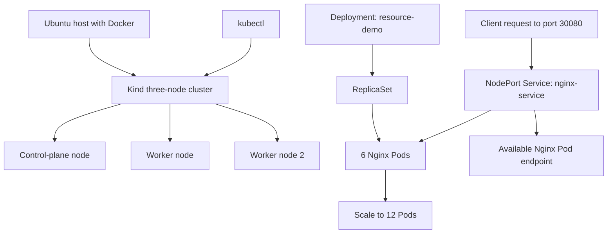

**Workflow:**

1. Prepare Docker, Kind, and kubectl.
2. Create and verify the three-node cluster.
3. Check node resource usage.
4. Apply the six-replica Nginx Deployment.
5. Inspect Pod placement, events, and node allocation.
6. Scale the Deployment to twelve replicas.
7. Create a NodePort Service and inspect its endpoints.
8. Send HTTP requests through the Service.
9. Create a high-resource Pod to observe a scheduling failure.
10. Delete the experiment resources.

## 6. Implementation

### Step 1 — Verify the cluster

The recording shows the Kind cluster `practical-cluster` and three nodes in the `Ready` state.

```bash
kind get clusters
kubectl get nodes -o wide
```

The three nodes shown were:

- `practical-cluster-control-plane`
- `practical-cluster-worker`
- `practical-cluster-worker2`

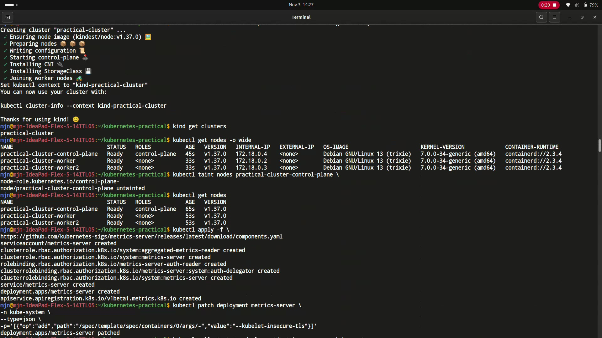

### Step 2 — Check node resource utilization

```bash
kubectl top nodes
```

The captured output showed the following initial usage:

| Node | CPU usage | CPU usage % | Memory usage | Memory usage % |
|:--|--:|--:|--:|--:|
| Control plane | 167m | 4% | 710Mi | 9% |
| Worker | 34m | 0% | 153Mi | 2% |
| Worker 2 | 29m | 0% | 135Mi | 1% |

These values are a point-in-time sample from the recording. They can change between runs.

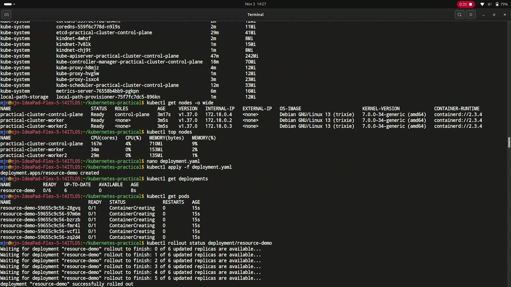

### Step 3 — Create the six-replica Deployment

Create `deployment.yaml` using the configuration in [`kubernetes/deployment.yaml`](kubernetes/deployment.yaml).

Apply it:

```bash
kubectl apply -f kubernetes/deployment.yaml
kubectl get deployments
kubectl get pods
kubectl rollout status deployment/resource-demo
```

The Deployment uses:

| Setting | Value |
|:--|:--|
| Deployment name | `resource-demo` |
| Container | `nginx` |
| Image | `nginx` |
| Replicas | 6 |
| CPU request | `100m` |
| Memory request | `64Mi` |
| CPU limit | `200m` |
| Memory limit | `128Mi` |

The recording shows all six Pods reaching `Running` and `Ready` status.

### Step 4 — Inspect Pod scheduling

```bash
kubectl get pods -o wide
kubectl get events --sort-by=.metadata.creationTimestamp
```

The `NODE` column identifies the node hosting each Pod. The recording shows two Pods on each of the three nodes for the six-replica Deployment.

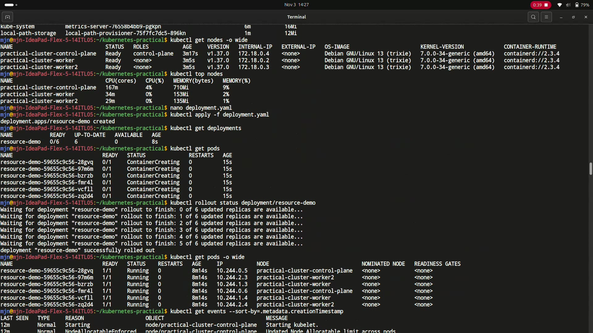

Scheduling events show Pod creation, image pulling, and successful assignment to nodes.

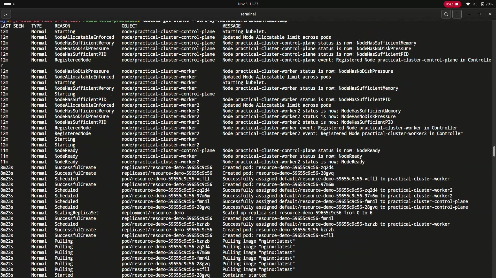

### Step 5 — Inspect resource allocation and Pod usage

```bash
kubectl describe nodes
kubectl top pods
```

Use `kubectl describe nodes` to inspect node capacity, allocatable resources, and the allocated-resource section. Use `kubectl top pods` to view current CPU and memory consumption.

Requests and limits are not the same as live usage:

- **Requests** influence scheduling.
- **Limits** cap container resource consumption.
- **Metrics** show observed consumption at the time of the query.

## 7. Kubernetes Configuration Files

### 7.1 Deployment manifest

The repository includes [`kubernetes/deployment.yaml`](kubernetes/deployment.yaml), based on the Experiment 4 manual.

```yaml
apiVersion: apps/v1
kind: Deployment
metadata:
  name: resource-demo
spec:
  replicas: 6
  selector:
    matchLabels:
      app: resource-demo
  template:
    metadata:
      labels:
        app: resource-demo
    spec:
      containers:
        - name: nginx
          image: nginx
          resources:
            requests:
              cpu: "100m"
              memory: "64Mi"
            limits:
              cpu: "200m"
              memory: "128Mi"
```

### 7.2 Service manifest

The repository includes [`kubernetes/service.yaml`](kubernetes/service.yaml), based on the Experiment 4 manual.

```yaml
apiVersion: v1
kind: Service
metadata:
  name: nginx-service
spec:
  type: NodePort
  selector:
    app: resource-demo
  ports:
    - port: 80
      targetPort: 80
      nodePort: 30080
```

The Service selector `app: resource-demo` matches the labels on the Deployment Pods.

## 8. Resource Allocation and Scheduling

The node description output in the recording includes the requested and limited CPU/memory values for Pods. It also shows the node capacity and allocatable resource sections.

To inspect these details:

```bash
kubectl describe nodes
kubectl describe node practical-cluster-worker
```

The exact output depends on the current cluster state. In particular, the recording includes system Pods such as `kindnet`, `kube-proxy`, and `metrics-server`; these also consume node resources.

## 9. Scaling from Six to Twelve Pods

Scale the Deployment:

```bash
kubectl scale deployment resource-demo --replicas=12
kubectl get deployments
kubectl get pods -o wide
```

The captured output shows twelve running Nginx Pods. In that output, the Pods are distributed as follows:

| Node | Pods shown |
|:--|--:|
| `practical-cluster-control-plane` | 4 |
| `practical-cluster-worker` | 4 |
| `practical-cluster-worker2` | 4 |
| **Total** | **12** |

This is the distribution observed in the recording, not a guarantee that Kubernetes will always distribute replicas equally. Actual placement depends on available resources and scheduling constraints.

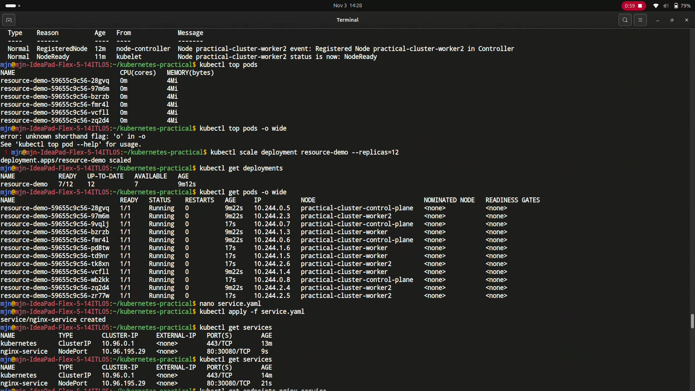

## 10. Service and Load-Balancing Test

### Step 1 — Create the Service

```bash
kubectl apply -f kubernetes/service.yaml
kubectl get services
```

The recording shows:

| Property | Observed value |
|:--|:--|
| Service | `nginx-service` |
| Type | `NodePort` |
| Cluster IP | `10.96.195.29` |
| Service port | `80` |
| NodePort | `30080` |
| Target port | `80` |

The ClusterIP is specific to the recorded cluster and may be different in another run.

### Step 2 — Inspect endpoints

```bash
kubectl get endpoints nginx-service
kubectl get endpointslices
kubectl describe service nginx-service
```

The recording shows endpoint addresses including `10.244.0.5:80`, `10.244.0.6:80`, and `10.244.0.7:80`, followed by additional endpoints. The EndpointSlice output also lists backend Pod IPs.

The terminal prints a warning that the legacy Endpoints API is deprecated in Kubernetes v1.33+ and recommends EndpointSlice discovery. For newer workflows, prefer:

```bash
kubectl get endpointslices
```

### Step 3 — Send requests through the Service

The recording tests the Service from the local machine with:

```bash
for i in {1..10}; do
  curl -s -o /dev/null -w "Request $i: HTTP %{http_code}\n" http://localhost:30080
done
```

All ten captured responses returned `HTTP 200`.

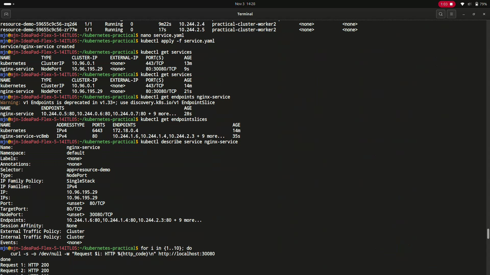

A successful HTTP response confirms that the application was reachable through the Service. It does not, by itself, demonstrate equal traffic distribution across every backend Pod.

## 11. Resource-Constrained Scheduling Extension

The recording also demonstrates the suggested practical extension from the lab manual: create a Pod with a CPU request too large for the available nodes.

The visible terminal commands include:

```bash
kubectl apply -f high-resource.yaml
kubectl get pods -o wide
kubectl describe pod -l app=high-resource-demo
kubectl get events --sort-by=.metadata.creationTimestamp
```

The Pod `high-resource-demo` remained `Pending`. The captured Pod description showed:

- Image: `nginx:latest`
- CPU request: `100`
- Memory request: `64Mi`
- No node assigned
- `PodScheduled: False`

The scheduler event reported:

```text
0/3 nodes are available: 3 Insufficient cpu.
preemption: 0/3 nodes are available: 3 Preemption is not helpful for scheduling.
```

In Kubernetes CPU quantity notation, the recorded request `100` means 100 CPU cores, not `100m`. This explains why it could not be scheduled on the recorded nodes. The original high-resource YAML file was not included in the supplied materials, so this repository does not invent or recreate that manifest.

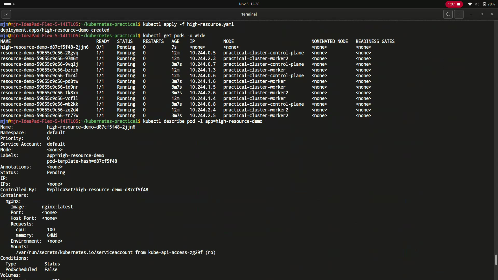

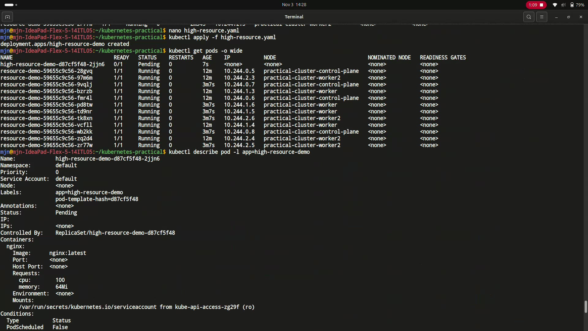

### Why did the Pod remain Pending?

The scheduler checks whether a node has enough allocatable CPU to satisfy a Pod's CPU request. Since the request shown was far beyond the capacity of each node, none of the three nodes was eligible. The Pod therefore remained Pending instead of starting.

This demonstrates the difference between:
- a Pod that cannot be scheduled because its request cannot be satisfied; and
- a running Pod whose actual CPU usage happens to be low.

## 12. Observations and Results

### 12.1 Observation summary

| Experiment stage | Observation from the recording |
|:--|:--|
| Cluster verification | Three nodes were in `Ready` state |
| Initial node metrics | CPU and memory usage were displayed for all three nodes |
| Six-replica Deployment | Six Nginx Pods reached `Running` |
| Initial scheduling | Two Pods were shown on each node |
| Scaling | Deployment was scaled from 6 to 12 replicas |
| Scaled scheduling | Four Pods were shown on each node in the captured output |
| Service | `nginx-service` was created as NodePort |
| NodePort | Port `30080` |
| Endpoints | Backend Pod IPs were registered |
| HTTP test | Ten requests returned `HTTP 200` |
| Scheduling extension | High-resource Pod stayed `Pending` |
| Scheduling event | `3 Insufficient cpu` |
| Cleanup | `resource-demo`, `high-resource-demo`, and `nginx-service` were deleted |

### 12.2 Result

Resource allocation, Pod scheduling, and Service-based load balancing were demonstrated using a three-node Kubernetes cluster. The six-replica Deployment was scaled to twelve replicas, a NodePort Service exposed the Nginx application, and HTTP requests through the Service returned successful responses. The resource-constrained scheduling extension produced a Pending Pod because the CPU request exceeded available node capacity.

### 12.3 Limitations of the captured evidence

- The recording does not show a browser window displaying the Nginx welcome page; it shows successful `curl` HTTP status responses.
- The HTTP test does not measure per-Pod request counts and therefore does not prove equal traffic distribution.
- The high-resource manifest itself is not present in the supplied ZIP or lab manual. Only the Pod description and scheduling failure are visible in the recording.
- The manual asks for before/after resource-utilization comparison. The recording shows node metrics and Pod metrics, but does not provide a complete tabulated before/after comparison for every stage.
- The recording shows a local Kind cluster, while the manual describes an existing three-node cluster. The recorded implementation is documented as performed rather than silently replaced with the manual's assumed environment.

## 13. Cleanup

The recording shows the following cleanup commands:

```bash
kubectl delete deployment high-resource-demo
kubectl delete service nginx-service
kubectl delete deployment resource-demo
```

It then checks the remaining resources:

```bash
kubectl get deployments
kubectl get services
kubectl get pods
```

The output shows no remaining application Deployments or Pods in the default namespace. The built-in `kubernetes` Service remains.

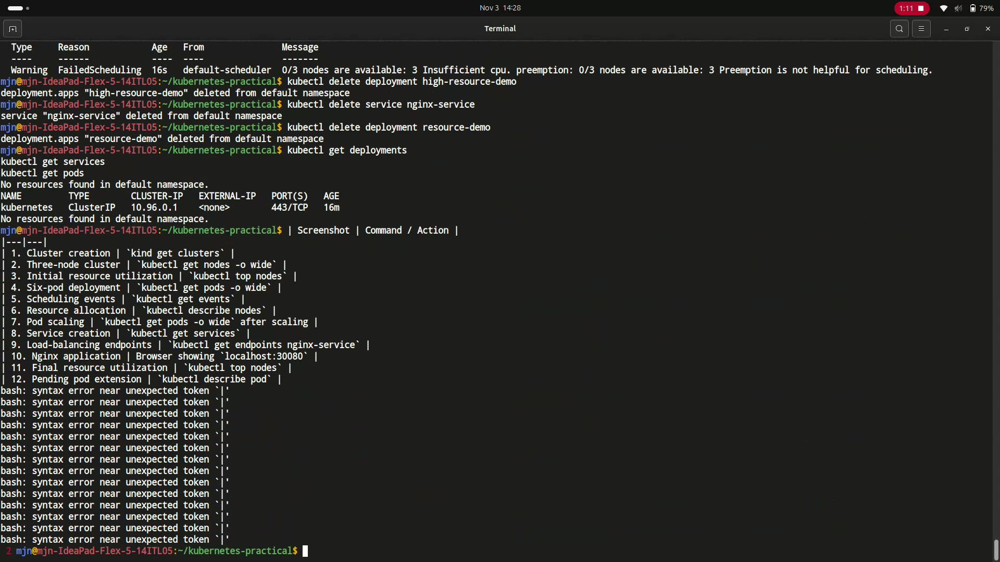

The Kind cluster itself is not shown being deleted; the cleanup removes the experiment resources while leaving the cluster intact.

## 14. Troubleshooting and Notes

| Issue | Explanation / action |
|:--|:--|
| `kubectl top nodes` has no metrics | Verify that Metrics Server is installed and ready: `kubectl get deployment metrics-server -n kube-system` |
| Pod remains `Pending` | Run `kubectl describe pod POD_NAME` and inspect scheduling events |
| `Insufficient cpu` | The Pod's CPU request cannot fit on any eligible node; review node allocatable CPU and the Pod request |
| Service has no endpoints | Check that the Service selector matches the Pod labels and that Pods are Ready |
| NodePort is unreachable | Verify the Service, node address, port, Kind networking, and host firewall rules |
| Endpoints deprecation warning | Use `kubectl get endpointslices` for EndpointSlice-based backend discovery |
| `kubectl top` values differ between runs | Metrics are point-in-time measurements and change with system activity |

Useful inspection commands:

```bash
kubectl get nodes -o wide
kubectl top nodes
kubectl get deployments
kubectl get pods -o wide
kubectl get events --sort-by=.metadata.creationTimestamp
kubectl describe nodes
kubectl top pods
kubectl get services
kubectl get endpointslices
kubectl describe pod POD_NAME
```

## 15. Repository Structure

```text
Experiment-4-Kubernetes/
├── README.md
├── .gitignore
├── screenshots/
│   ├── 01-cluster-and-node-verification.jpg
│   ├── 02-resource-usage-and-six-replica-deployment.jpg
│   ├── 03-six-pods-scheduled-across-three-nodes.jpg
│   ├── 04-scheduler-events-and-pod-placement.jpg
│   ├── 05-twelve-replica-scaling-and-service-creation.jpg
│   ├── 06-nodeport-service-endpoints-and-http-tests.jpg
│   ├── 07-high-resource-pod-pending.jpg
│   ├── 08-high-resource-pod-request-details.jpg
│   └── 09-insufficient-cpu-event-and-cleanup.jpg
├── kubernetes/
│   ├── deployment.yaml
│   └── service.yaml
└── docs/
    ├── experiment-details.md
    └── screenshot-index.md
```

## 16. Conclusion

The experiment demonstrated the role of Kubernetes resource requests and limits in Pod scheduling, the placement of replicas across multiple nodes, and the use of a NodePort Service to expose an application. Scaling the Deployment from six to twelve replicas showed how Kubernetes schedules additional Pods according to cluster resources. The high-resource Pod extension demonstrated how an excessive CPU request can prevent scheduling and leave a Pod in the Pending state.

The practical provides a working demonstration of resource allocation, scheduling decisions, scaling, Service endpoints, and application access through Kubernetes networking.

## Graphs and Visual Comparisons

The repository includes a small set of SVG comparison graphs generated from the recorded experiment results. These charts summarize the key observations from the Kubernetes scheduling and service checks.

### 1. Node CPU usage

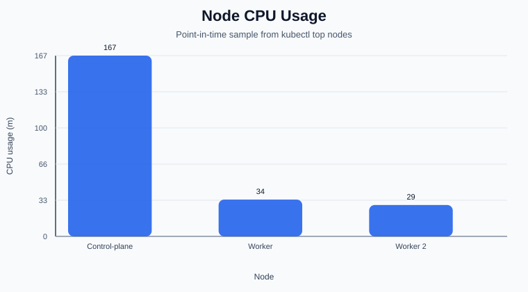

This chart compares the observed CPU usage of the three nodes at the start of the experiment. The control-plane node shows the highest utilization, while worker nodes remain comparatively low.

### 2. Node memory usage

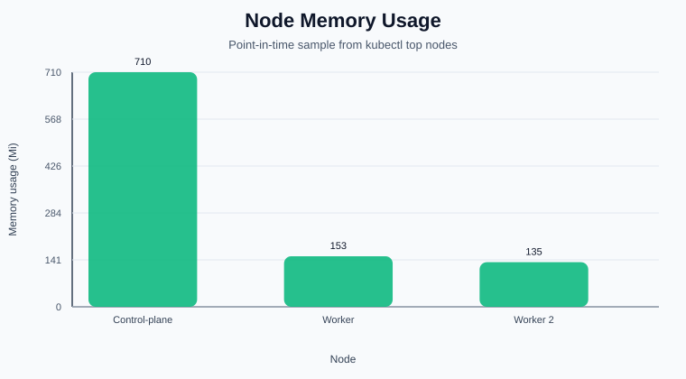

This chart compares the memory footprint of each node. The values represent the recorded point-in-time sample from `kubectl top nodes` during the early deployment stage.

### 3. Pod distribution before and after scaling

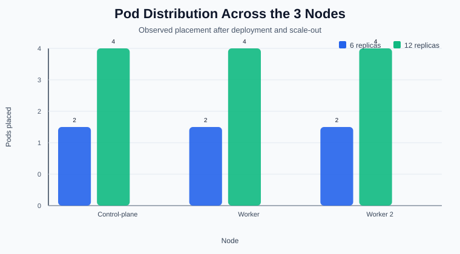

The chart shows the pattern of Pod placement before and after scaling. At six replicas, the workload is spread evenly as 2 pods per node. After scaling to twelve replicas, the cluster shows 4 pods on each node, confirming balanced placement across all three nodes.


